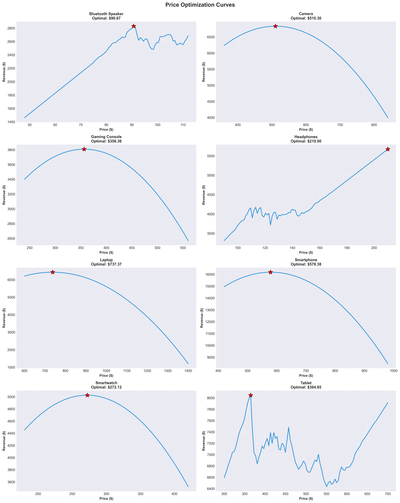

# Electronics Price Optimization

A machine learning pipeline that estimates how demand for 8 electronics products responds to price, finds the revenue-maximising price for each, and compares pricing strategies in a Streamlit dashboard.



## What it does

1. **Data:** generates 2 years of daily sales (5,840 records) for 8 products (laptop, smartphone, tablet, smartwatch, headphones, Bluetooth speaker, gaming console, camera) with price, competitor price, promotions and weekends. *The data is synthetic*, generated with a known price elasticity per product so the models can be checked against the truth.
2. **EDA:** price distributions, price vs demand, monthly patterns, revenue by product (`electronics_pricing/data/eda_outputs/`).
3. **Demand models:** Linear Regression, Random Forest and XGBoost per product (24 models).
4. **Price elasticity:** classifies each product as elastic or inelastic.
5. **Optimisation:** tests 100 price points per product and picks the price with the highest predicted revenue.
6. **Strategy simulation:** compares aggressive, competitive and premium pricing.

## Results

- Model R² ranged from **0.43 to 0.81** across products.
- **Plain Linear Regression matched or beat XGBoost for most products.** This makes sense: the data was generated from a mostly linear price–demand relationship, so a simple model fits it well and the complex ones overfit the noise.
- Large "revenue uplift" figures from the optimiser come from synthetic data and should not be read as real-world gains.

## Tech stack

Python · pandas · NumPy · scikit-learn · XGBoost · Matplotlib / Seaborn · Plotly · Streamlit

## Run it

```
cd electronics_pricing
pip install -r requirements.txt
python main.py                      # full pipeline: data, EDA, models, optimisation
streamlit run dashboard/app.py      # dashboard
```

## Project structure

```
electronics_pricing/
├── main.py              # runs the full pipeline
├── modules/             # data generator, EDA, demand model, elasticity, optimizer, simulator
├── dashboard/app.py     # Streamlit dashboard
├── data/                # generated data and EDA charts
└── models/              # trained models and metrics
```

## What I'd improve next

Use real sales data, add time-series features (seasonality, trends), and validate on a held-out time period.
